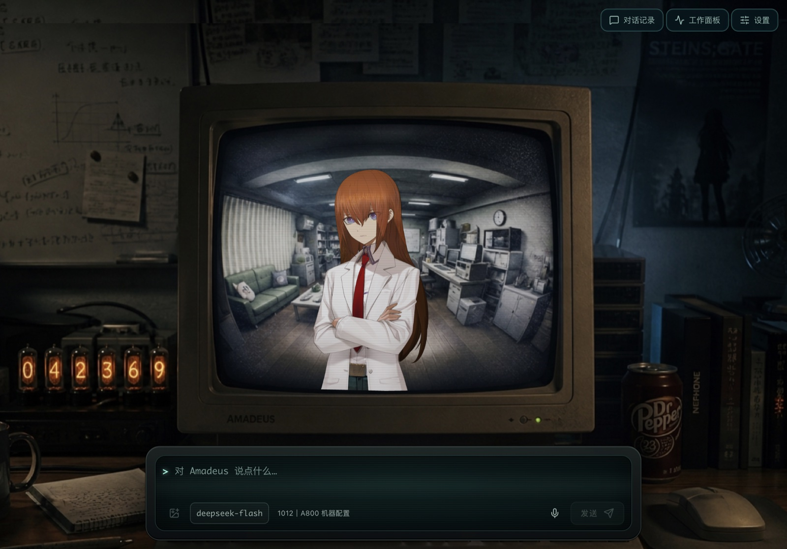

<div align="center">


# Amadeus Next

**住在显像管里的红莉栖：会说话、有表情、记得你，还能替你把活干完。**

<a href="https://github.com/Mieluoxxx/amadeus-next/releases"></a>

<a href="LICENSE"></a>

</div>

<p align="center">
  
</p>

Amadeus Next 是一个 macOS 桌面应用。它把《命运石之门》里的 Amadeus 搬到你的桌面上：
红莉栖待在未来道具研究所的旧显示器里，你可以直接开口跟她说话，她用自己的声音回答，
口型和表情跟着语音一起动。

她不只是陪聊。查资料、读文件、改代码、登上远程服务器跑命令，这些活她会交给后台的
子代理去做，自己继续陪你说话；做完了再回来告诉你结果。

## 功能一览

### 开口就能聊

- **语音对话**：macOS 原生语音识别听你说话，Fish Audio 流式合成她的声音，首包就开播，不用等整段生成完。
- **连续对话模式**：说完一句自动提交；她回答时话筒自动让位，说完再继续听。
- **随时打断**：生成、合成、播放任何阶段都可以停下来。
- **文字也行**：语音不方便时直接打字，语音出错也不影响文字聊天。

### 有表情的红莉栖

- **E-mote 动态立绘**：白大褂红莉栖，眨眼、口型、表情都是实时驱动，不是视频帧。
- **口型跟着真实播放走**：嘴型按实际播出的音频能量开合，静音、缓冲、播完都会合上。
- **表情和台词对齐**：模型可以在台词里埋表情标记，借助 Fish 的逐词时间戳，表情在说到那句话时才切换。
- **CRT 场景**：研究所房间、显像管弯曲、字幕框、氛围光层，还有桌上的辉光管世界线变动率计。

### 交给她去办

红莉栖自己不碰工具，她把活委托给专门的子代理，在后台并行执行：

| 子代理 | 能做什么 |
| :--- | :--- |
| **调研** | 联网检索、抓取网页、整理资料 |
| **文件** | 只读访问你授权的目录 |
| **任务** | 在本机读写文件、执行命令；每次写操作都要你确认 |
| **远程** | 通过 SSH 在你的服务器上开发、构建、测试 |

- **工作面板**：谁在跑、跑了多久、调用了多少次工具、花了多少 token，点开能看到完整时间线。
- **可续接、可追问**：结果不满意就让她接着同一个任务再来一轮；子代理缺信息时会通过她来问你。
- **Skills 与 MCP**：子代理能使用你配置的 skills 和 MCP server。
- **委托专用模型**：主对话用快模型保证响应速度，后台任务可以换成更强的模型。

### 她记得你

- **长期记忆**：让她记住或忘掉某件事；她觉得值得记的内容会先作为提议，等你确认后才真正写入。
- **记忆就是 Markdown**：存在本地，你可以直接打开编辑、备份。
- **会话自动命名**：每段对话按话题自动起标题，方便回头翻找。
- **崩溃不丢**：对话、任务、汇报都持久化在本地，重启后后台任务接着跑，没送达的汇报会补上。

### 设置

在设置页切换对话模型与思考档位、配置 Fish Audio 音色、管理远程机器、设置网络代理、
查看和确认长期记忆、安装角色资源。API 密钥由系统钥匙串加密保存。

## 快速开始

### 1. 安装

从 [Releases](https://github.com/Mieluoxxx/amadeus-next/releases) 下载
`Amadeus-<版本>-arm64.dmg`，拖进「应用程序」。

> [!NOTE]
> 目前只提供 Apple Silicon 版本，安装包没有签名。首次打开如果被系统拦截，
> 在「系统设置 → 隐私与安全性」里点「仍要打开」。

### 2. 配置模型

Amadeus 的对话由 [Pi](https://github.com/earendil-works/pi) 驱动，直接读取 Pi 的模型与凭据配置
（`~/.pi/agent/`）。配好 Pi 后，在设置页「模型配置」里选择要用的模型。

### 3. 配置语音

在设置页「语音配置」里填入 [Fish Audio](https://fish.audio) 的 API Key 和音色 ID。
默认使用 Fish 的免费模型 `s2.1-pro-free`。

### 4. 安装角色资源

E-mote 角色模型属于原版权方，**不随应用分发**。请自行准备 `emote.zip`，
在设置页「通用 → 角色资源」点「从 emote.zip 安装」。没有角色资源时应用照常可用，
只是显示器里没有红莉栖。

首次对话时 macOS 会请求麦克风和语音识别权限。

## 从源码构建

需要 Node.js 24 与 Xcode 命令行工具（编译语音识别助手）。

```bash
npm ci
npm run dev            # 开发模式，支持热更新
npm start              # 构建并运行
./build_app.sh         # 打包 dmg
```

架构、热更新机制、故障诊断与测试说明见 [docs/development.md](docs/development.md)
和 [docs/architecture.md](docs/architecture.md)。

## 致谢

Amadeus Next 源自 [**Code-Amadeus/Amadeus**](https://github.com/Code-Amadeus/Amadeus)。
它的场景设计、美术资源和「让 Amadeus 真正走到桌面上」的想法，是这个项目的起点。
感谢 Amadeus 的所有贡献者 ♡

**也推荐你去试试 [Amadeus](https://github.com/Code-Amadeus/Amadeus)！** 它是一个更完整的实时多模态桌面
Agent：支持 Windows / macOS / Linux，可以用本地模型推理（CUDA、ROCm、Apple MPS），
提供 Live2D 角色、桌面主题、插件体系和 Provider 工作台。想在 Windows 上用、
想全部本地跑，或者想要更多可玩性，Amadeus 都是很好的选择。
→ [项目主页](https://github.com/Code-Amadeus/Amadeus) · [官网](https://code-amadeus.github.io/) · [演示视频](https://www.bilibili.com/video/BV1783G6hEYY/)

同时感谢这些项目：

- [Pi](https://github.com/earendil-works/pi)：Agent 运行时与持久化
- [Fish Audio](https://fish.audio)：语音合成
- [FreeMote](https://github.com/Project-AZUSA/FreeMote)：E-mote 运行时
- [Electron](https://www.electronjs.org/)、[React](https://react.dev/)、[PixiJS](https://pixijs.com/)

## 许可证与声明

Amadeus Next 的第一方代码、文档与原创品牌素材以
[GNU Affero General Public License v3.0](LICENSE)（AGPL-3.0）发布。
第三方组件保留各自的许可条款，详见
[resources/THIRD_PARTY_NOTICES.md](resources/THIRD_PARTY_NOTICES.md)。

Amadeus Next 是非官方的同人爱好项目，与 MAGES.、Nitroplus、5pb.
及《命运石之门》系列的任何权利方**均无关联，也未获其认可**。角色名称、模型、美术与动画归各自权利人所有，
本项目仅作个人、非商业的实验用途。本项目不收费，不提供商业支持、托管或分发服务。
AGPL-3.0 只覆盖第一方代码与文档，不授予角色、模型、语音等第三方素材的任何权利。
